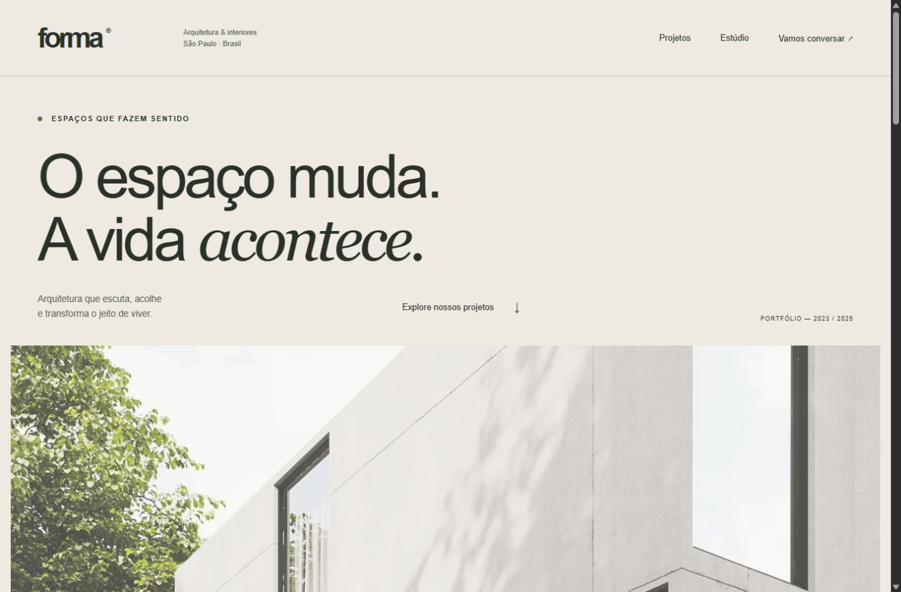

# Forma — arquitetura para viver

Site editorial de um estúdio fictício de arquitetura, com foco em composição visual, responsividade e uma experiência leve de navegação.

**[Abrir demonstração](https://gustapaz.github.io/forma-studio/)**



## Experiência

- Página inicial editorial, estúdio, catálogo e seis páginas individuais de projetos.
- Filtros por categoria, estado vazio e referências favoritas persistidas no dispositivo.
- Briefing com validação nativa, estimativa ilustrativa por área e escopo, resumo em modal e download de arquivo de texto.
- FAQ, política de privacidade e créditos, página 404 e navegação móvel.
- HTML estático indexável, metadados sociais, canonical por rota e sitemap.
- Imagens WebP responsivas em três tamanhos, dimensões explícitas e carregamento tardio fora da capa.
- Foco visível, link para pular conteúdo, formulários rotulados, modal nativo e respeito a movimento reduzido.

## Stack e execução

Astro, TypeScript e CSS. Sem framework de interface no cliente, fontes externas ou serviços de aplicação.

Requer Node.js 24 e npm.

```sh
npm ci
npm run dev
npm test
npm run build
npm run preview
```

Acesse `/forma-studio/`. A base e o domínio de produção estão em `astro.config.mjs`. O workflow executa testes, checagem de tipos e build antes de publicar no GitHub Pages. A hospedagem usa repositório público e não requer faturamento ou cartão.

## Dados demonstrativos e privacidade

O estúdio, nomes dos projetos, áreas, cidades e descrições são fictícios. As imagens são referências visuais e não representam obras executadas pelo estúdio. A estimativa não é um orçamento e não inclui obra ou materiais.

Nenhum formulário é enviado. Não há backend, banco, API de aplicação, login ou analytics. O briefing existe apenas na memória da página; o arquivo é gerado localmente. Os favoritos usam a chave `forma-saved` do localStorage e podem ser apagados na página de privacidade. O GitHub pode processar registros técnicos da hospedagem conforme sua própria política.

## Validação

Testes automatizados verificam os valores ilustrativos e as áreas inválidas. `astro check` e build estático verificam as rotas e tipos. Inspeção no navegador cobre desktop, celular, filtros, persistência, formulário e comportamento do modal por teclado. Não há pontuação Lighthouse ou certificação de acessibilidade declarada.

## Imagens e licença

Código: [MIT](LICENSE), Gustavo Paz. Imagens excluídas da licença MIT, utilizadas sob a [licença Pexels](https://www.pexels.com/license/):

| Referência visual | Origem |
| --- | --- |
| Casa Horizonte | [Pexels 13041123](https://www.pexels.com/photo/13041123/) |
| Apartamento Essência | [Pexels 1643383](https://www.pexels.com/photo/1643383/) |
| Galeria Concreta | [Pexels 11312129](https://www.pexels.com/photo/11312129/) |
| Casa Pátio | [Pexels 13041127](https://www.pexels.com/photo/13041127/) |
| Edifício Ritmo | [Pexels 7078182](https://www.pexels.com/photo/7078182/) |
| Refúgio Urbano | [Pexels 19889118](https://www.pexels.com/photo/19889118/) |

As imagens foram recortadas e otimizadas para WebP com Sharp. `optimize.mjs` reproduz o processamento de arquivos JPG adicionados em `public/images/`. Bibliotecas mantêm suas licenças originais.
